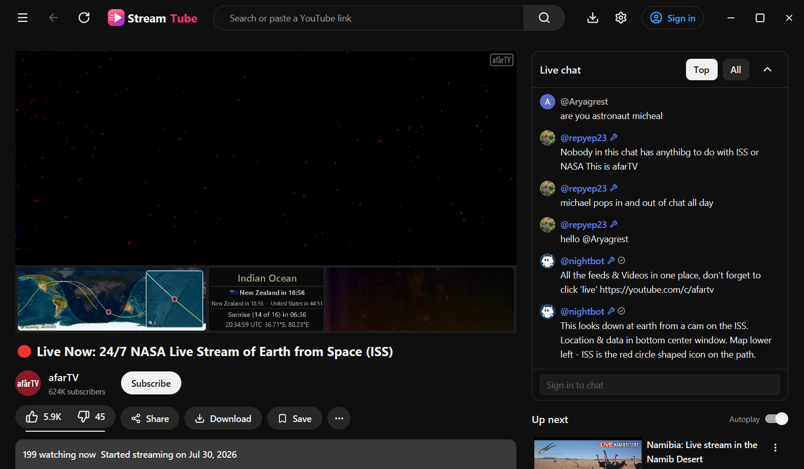
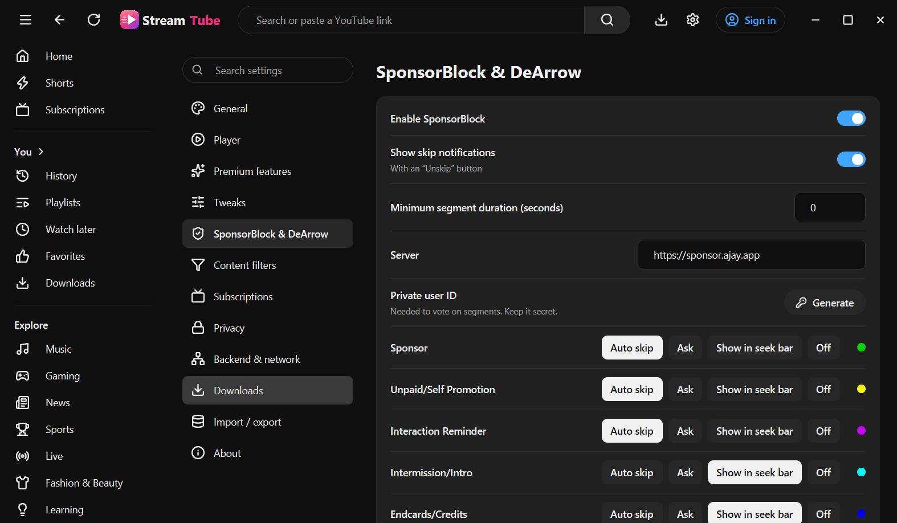

<p align="center">
  
</p>

<h1 align="center">Stream Tube</h1>

<p align="center">
  A native YouTube client for Windows, written in Rust.<br>
  No browser, no ads, no tracking. SponsorBlock, DeArrow and Return YouTube Dislike built in.
</p>

<p align="center">
  
  
  
</p>

<p align="center">
  
</p>

## Why

I wanted YouTube on my desktop without keeping a browser tab open, and without the
ads, autoplaying junk and sponsor reads. The existing options were either Electron
apps that eat a gigabyte of RAM or web frontends that break every other week.
Stream Tube is a single native app: the UI is drawn on the GPU with
[GPUI](https://github.com/zed-industries/zed/tree/main/crates/gpui), and video
goes through libmpv, so it starts fast and scrolls smoothly even with big feeds.

## What it does

**Watching**
- Home, Shorts, Subscriptions, Explore categories, channels, playlists and search
- libmpv player with hardware decoding, codec preference, speed control (remembered per channel if you want), captions and seek-bar preview thumbnails
- Resumes where you left off, a miniplayer while you browse, and a picture-in-picture window
- Keeps playing when minimized, has an audio-only mode, or can hand a video off to an external player
- Live streams with live chat (Top chat or every message), and chatting when signed in
- Hold Space or press and hold on the video to play at 2x

**Less noise**
- SponsorBlock with per-category behaviour: skip automatically, ask, only mark it on the seek bar, or ignore
- DeArrow titles and thumbnails, so you see what a video is actually about
- Return YouTube Dislike counts
- Hide Shorts, live streams, premieres, comments, related videos, view counts and more
- Block channels or keywords from every feed

**Your data stays yours**
- Subscriptions can live locally. The feed is built by fetching each channel directly, no account needed
- Or sign in with your Google account to get your own Home feed, subscriptions, watch history, playlists, likes and subscribe button
- History, watch later, favourites and playlists are stored in a local SQLite database
- Import from YouTube Takeout, NewPipe, FreeTube or OPML. Export to NewPipe JSON, YouTube CSV, OPML or a full backup

**Downloads**
- Download video or audio in any quality through yt-dlp, with SponsorBlock chapters
- Without yt-dlp it falls back to the built-in downloader (360p/720p or audio)

**Looks the way you like**
- Dark, light or follow Windows
- Six accent colours, interface scaling, density, thumbnail corner style and grid columns

## Screenshots

<table>
  <tr>
    <td></td>
    <td></td>
  </tr>
  <tr>
    <td align="center">Live streams with chat</td>
    <td align="center">Search</td>
  </tr>
  <tr>
    <td></td>
    <td></td>
  </tr>
  <tr>
    <td align="center">Settings</td>
    <td align="center">SponsorBlock and DeArrow</td>
  </tr>
</table>

## Building

You need:

- **Rust 1.85 or newer** (the crate uses the 2024 edition). Get it from [rustup.rs](https://rustup.rs).
- **libmpv** — download a `mpv-dev-x86_64` archive from
  [shinchiro's mpv builds](https://github.com/shinchiro/mpv-winbuild-cmake/releases)
  and put `libmpv-2.dll` in `third_party/mpv/`. It isn't in the repo because it's over 100 MB.
- **yt-dlp** (optional, recommended) — on your `PATH`, or point to it in
  *Settings → Backend & network*. It's used for downloads and as a fallback when
  the built-in extractor can't get a stream.

Then:

```powershell
git clone https://github.com/Avaneesh-Inamdar/Stream-Tube-Desktop.git
cd Stream-Tube-Desktop
cargo build --release
```

The executable ends up at `target\release\streamtube.exe`. To run it somewhere
else, copy `libmpv-2.dll` next to it.

## Where things are stored

Settings, history and subscriptions go in `%APPDATA%\StreamTube\streamtube.db`.
If you used the app back when it was called Ferrotube, your old data is moved
over automatically on first launch.

## Project layout

```
src/
  api/       Innertube client, stream extraction, sign-in, SponsorBlock/DeArrow/RYD
  player/    libmpv binding, playback controller, player UI, local stream proxy
  ui/        app shell, pages (home, watch, shorts, settings, ...), cards, PiP window
  feed.rs    local subscription feed
  import.rs  Takeout / NewPipe / FreeTube / OPML import
  store.rs   SQLite storage
```

## Known issues

- YouTube sometimes answers with "Sign in to confirm you're not a bot". When that
  happens, signing in inside the app or updating yt-dlp usually fixes it.
- Windows is the only platform tested so far. The code isn't Windows-specific in
  most places, so Linux and macOS builds may work with a bit of effort.

## Credits

Stream Tube leans on a lot of other people's work:
[mpv](https://mpv.io), [yt-dlp](https://github.com/yt-dlp/yt-dlp),
[SponsorBlock](https://sponsor.ajay.app), [DeArrow](https://dearrow.ajay.app),
[Return YouTube Dislike](https://returnyoutubedislike.com) and
[GPUI](https://www.gpui.rs).

It's an independent project and isn't affiliated with or endorsed by YouTube or Google.

## License

[MIT](LICENSE)
