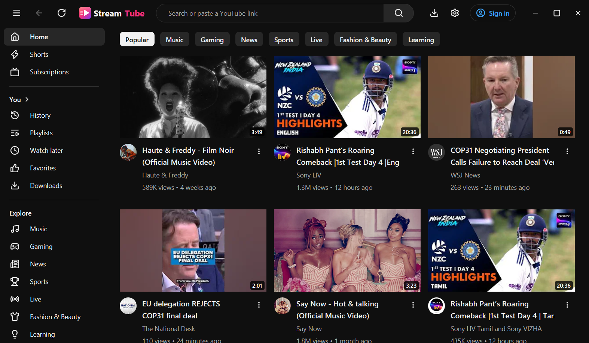
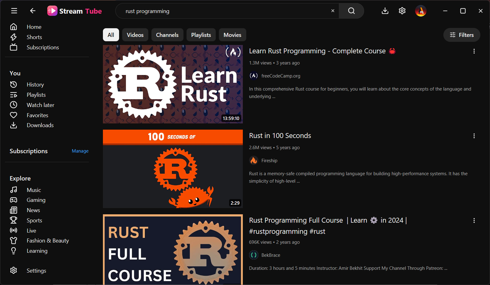
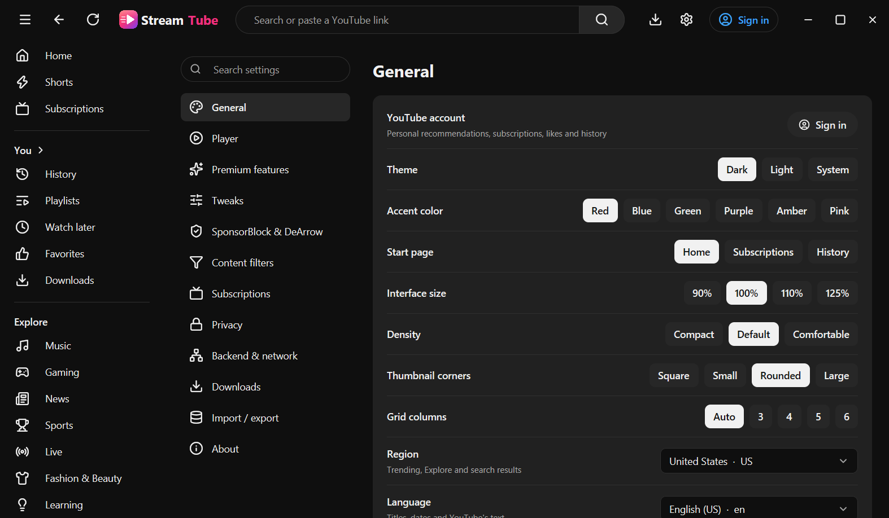

<p align="center">
  
</p>

<h1 align="center">Stream Tube</h1>

<p align="center">
  A native YouTube client for Windows and Linux, written in Rust.<br>
  No browser, no ads, no tracking. SponsorBlock, DeArrow and Return YouTube Dislike built in.
</p>

<p align="center">
  
  
  
  
</p>

<p align="center">
  
</p>

## Why

I wanted YouTube on my desktop without keeping a browser tab open, and without the
ads, autoplaying junk and sponsor reads. The existing options were either Electron
apps that eat a gigabyte of RAM or web frontends that break every other week.
Stream Tube is a single native app: the UI is drawn on the GPU with
[GPUI](https://github.com/zed-industries/zed/tree/main/crates/gpui), and video
goes through libmpv, so it starts fast and scrolls smoothly even with big feeds.

## What it does

**No ads, anywhere**
- No pre-roll, mid-roll or overlay ads: the app plays the video stream directly, so YouTube's ads are never loaded
- No promoted videos, banners or sponsored cards in Home, search or Shorts
- Sponsor reads inside videos are skipped too, with SponsorBlock (below)
- Nothing to install or keep updated: it isn't an ad blocker that YouTube can break, ads simply aren't part of how the app plays video

**Watching**
- Home, Shorts, Subscriptions, Explore categories, channels, playlists and search, with search suggestions and your recent searches
- libmpv player with hardware decoding, codec preference (AV1, VP9 or H.264), 360p up to 4K, enhanced bitrate, speed control (remembered per channel if you want), captions with adjustable size and background, chapters and seek-bar preview thumbnails
- Resumes where you left off, remembers your last quality, autoplays the next video or loops, and plays whole playlists as a queue
- A miniplayer while you browse, a picture-in-picture window, theater mode and fullscreen
- Keeps playing when minimized, or pauses and resumes when you come back
- Live streams with live chat (Top chat or every message), and chatting when signed in
- Shorts in a vertical player that moves to the next one by itself, or open them in the regular player
- Hold Space or press and hold on the video to play at 2x
- Hover previews: rest the pointer on a thumbnail and it plays inside it, muted, with a seek bar to skip around
- Most replayed graph with "jump ahead", ambient glow around the player, force original audio instead of auto-dubbing
- Keyboard shortcuts for everything you'd expect (play/pause, seek, volume, captions, fullscreen, theater, picture-in-picture, next/previous)
- Can hand a video off to an external player such as mpv or VLC

**Saves data**
- Audio only mode fetches just the audio stream, so podcasts, music and talks use a fraction of the data
- Pick a lower default quality, and turn off hover previews or seek-bar thumbnails if you're on a metered connection

**Premium features, free**
- No ads, background play, picture-in-picture, downloads, jump ahead and enhanced bitrate all work without YouTube Premium and without signing in

**Less noise**
- SponsorBlock with per-category behaviour: skip automatically, ask, only mark it on the seek bar, or ignore
- Use your own SponsorBlock private ID and see your contribution stats (segments, skips by others, time saved)
- DeArrow titles and thumbnails, so you see what a video is actually about
- Return YouTube Dislike counts
- Hide Shorts, live streams, premieres, watched videos, comments, related videos, description, chapters, channel avatars, view counts and Explore
- Block channels or keywords from every feed

**Your data stays yours**
- Subscriptions can live locally. The feed is built by fetching each channel directly, no account needed
- Or sign in with your Google account to get your own Home feed, subscriptions, playlists, likes and subscribe button
- Watch history and search history from your other devices sync in, with resume positions, and single entries can be removed
- History, watch later, favourites and playlists are stored in a local SQLite database, and you can pause or clear history at any time
- Import from YouTube Takeout, NewPipe, FreeTube or OPML. Export to NewPipe JSON, YouTube CSV, OPML or a full backup

**Downloads**
- Download video or audio in any quality through yt-dlp, with SponsorBlock chapters, from a download manager with progress
- Without yt-dlp it falls back to the built-in downloader (360p/720p or audio)

**Network**
- A proxy setting (HTTP or SOCKS) that covers browsing, playback, thumbnails, downloads and sign-in
- IPv4-only mode, and a choice of playback client (visionOS, Android VR or yt-dlp) if videos ever stop loading

**Looks the way you like**
- Dark, light or follow Windows
- Seven accent colours used across the app, and the app icon changes colour to match, on the taskbar and on your desktop shortcuts too
- Interface scaling, density, thumbnail corner style, grid columns, start page, language and region
- Smooth page, dialog and menu transitions

**Keeps itself up to date**
- Checks for new releases at startup and installs them in one click, and can update yt-dlp for you

## Performance

Stream Tube versus youtube.com in Microsoft Edge (clean profile, no extensions) on
the same Windows 11 PC, playing the same video. Numbers are the working set of
every process involved, after browsing a few pages.

| | youtube.com in Edge | Stream Tube 0.3.0-alpha |
|---|---|---|
| Processes | 11–12 | 1 |
| RAM, idle on Home | 1,073 MB | **~405 MB** |
| RAM, playing a video | 1,203 MB | **~565 MB** |

Stream Tube uses less than half the RAM of the browser, and it stays flat as you
browse: thumbnails are kept at the size they're drawn and the ones you've scrolled
past are freed. While playing, part of the memory is a read-ahead buffer that keeps
seeking instant. Turn on *Settings → Player → Hardware decoding* to decode video on
the GPU like the browser does. Results depend on the video, resolution and hardware.

## Screenshots

<table>
  <tr>
    <td></td>
    <td></td>
  </tr>
  <tr>
    <td align="center">Live streams with chat</td>
    <td align="center">Search</td>
  </tr>
  <tr>
    <td></td>
    <td></td>
  </tr>
  <tr>
    <td align="center">Settings</td>
    <td align="center">SponsorBlock and DeArrow</td>
  </tr>
</table>

## Install

Get the latest build from the [Releases page](https://github.com/Avaneesh-Inamdar/Stream-Tube-Desktop/releases).
This is an early alpha, so expect rough edges.

**Windows 10/11 (64-bit)**: run `StreamTube-<version>-setup.exe`. It installs for
your user only, so no administrator prompt, and the app updates itself when a new
release comes out (*Settings → About*).

**Debian, Ubuntu, Mint**: install the `.deb`. This also installs libmpv:

```sh
sudo apt install ./streamtube_0.3.0-alpha_amd64.deb
```

**Fedora, openSUSE**: install the `.rpm`:

```sh
sudo dnf install ./streamtube-0.3.0-alpha.x86_64.rpm
```

**Other Linux (x86_64)**: unpack `StreamTube-<version>-linux-x86_64.tar.gz` and run
`./install.sh`. It puts the app in `~/.local/bin` and adds a menu entry.
Video plays through libmpv, so install it if you don't have it:

```sh
sudo apt install libmpv2      # Debian 12+, Ubuntu 24.04+ (Ubuntu 22.04: libmpv1)
sudo dnf install mpv-libs     # Fedora
sudo pacman -S mpv            # Arch
```

Downloads above 360p need yt-dlp and FFmpeg. On Windows the app offers to fetch
both the first time you need them. On Linux, install them with your package manager.

## Building

You need:

- **Rust 1.85 or newer** (the crate uses the 2024 edition). Get it from [rustup.rs](https://rustup.rs).
- **libmpv** — download a `mpv-dev-x86_64` archive from
  [shinchiro's mpv builds](https://github.com/shinchiro/mpv-winbuild-cmake/releases)
  and put `libmpv-2.dll` in `third_party/mpv/`. It isn't in the repo because it's over 100 MB.
- **yt-dlp** (optional, recommended) — on your `PATH`, or point to it in
  *Settings → Backend & network*. It's used for downloads and as a fallback when
  the built-in extractor can't get a stream.

Then:

```powershell
git clone https://github.com/Avaneesh-Inamdar/Stream-Tube-Desktop.git
cd Stream-Tube-Desktop
cargo build --release
```

The executable ends up at `target\release\streamtube.exe`. To run it somewhere
else, copy `libmpv-2.dll` next to it.

To build the installer, install [Inno Setup 6](https://jrsoftware.org/isinfo.php) and run:

```powershell
ISCC.exe /DAppVersion=0.3.0-alpha installer\streamtube.iss
```

It lands in `dist\`. On Linux, install the packages listed in
[`.github/workflows/linux.yml`](.github/workflows/linux.yml) and run `cargo build --release`.

## Where things are stored

Settings, history and subscriptions go in `%APPDATA%\StreamTube\streamtube.db` on
Windows and `~/.local/share/StreamTube/streamtube.db` on Linux. Set `STREAMTUBE_DATA_DIR`
to keep them somewhere else (for example a portable copy).
If you used the app back when it was called Ferrotube, your old data is moved
over automatically on first launch.

## Project layout

```
src/
  api/       Innertube client, stream extraction, sign-in, SponsorBlock/DeArrow/RYD
  player/    libmpv binding, playback controller, player UI, local stream proxy
  ui/        app shell, pages (home, watch, shorts, settings, ...), cards, PiP window
  feed.rs    local subscription feed
  import.rs  Takeout / NewPipe / FreeTube / OPML import
  store.rs   SQLite storage
```

## Known issues

- YouTube sometimes answers with "Sign in to confirm you're not a bot". When that
  happens, signing in inside the app or updating yt-dlp usually fixes it.
- Windows is the main platform. The Linux build is new and less tested; macOS isn't built yet.

## Credits

Stream Tube leans on a lot of other people's work:
[mpv](https://mpv.io), [yt-dlp](https://github.com/yt-dlp/yt-dlp),
[SponsorBlock](https://sponsor.ajay.app), [DeArrow](https://dearrow.ajay.app),
[Return YouTube Dislike](https://returnyoutubedislike.com) and
[GPUI](https://www.gpui.rs).

It's an independent project and isn't affiliated with or endorsed by YouTube or Google.

## License

[MIT](LICENSE)
